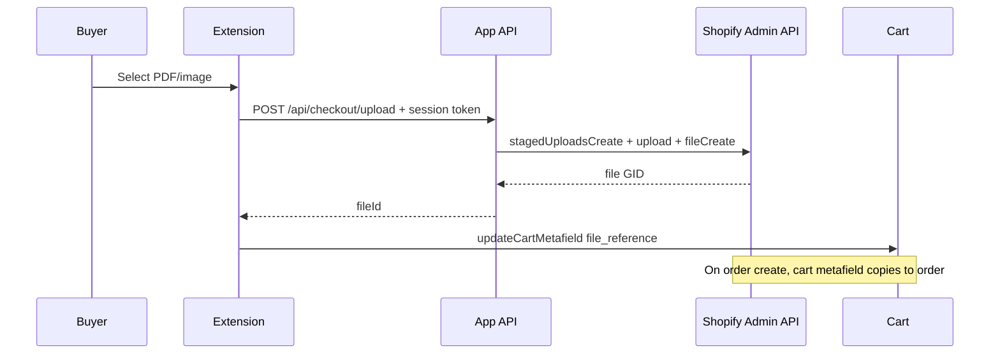

# B2B checkout document upload

Personal Shopify Plus prototype: a **checkout UI extension** so company buyers can attach a purchase order (PDF or image) during checkout. The file is stored in Shopify Files and linked on the cart via a `file_reference` metafield, then copied to the order when checkout completes.

> **Deploying to a permanent URL?** See [`DEPLOYMENT.md`](./DEPLOYMENT.md) for the hosting/handoff guide (replacing the temporary `shopify app dev` tunnel URL with an always-on server).

## What’s included

| Piece | Purpose |
| --- | --- |
| `extensions/b2b-document-upload/` | Checkout block: drop zone, B2B-only UI, cart metafield update |
| `app/routes/api.checkout.upload.tsx` | Authenticated upload API (`authenticate.public.checkout`) |
| `app/lib/shopify-file-upload.server.ts` | Staged upload + `fileCreate` via Admin API |
| Metafields in `shopify.app.toml` | `app.b2b_document` on cart and order (`cart_to_order_copyable`) |

## Requirements

- [Shopify CLI](https://shopify.dev/docs/apps/tools/cli) 3.85+
- Node.js 20.19+ or 22.12+
- **Shopify Plus** (for checkout UI on information / shipping / payment steps) unless your plan includes checkout extensibility on those steps
- B2B on the store (company location checkout)
- **Protected customer data** access in the Partner Dashboard (required for `purchasingCompany` / B2B detection). Without it, the extension cannot tell business vs retail buyers and will hide upload for everyone.

## Existing order metafield

If you already have an order `file_reference` metafield, align these three places to the same namespace and key:

1. `shopify.app.toml` — `[cart.metafields.app.*]` and `[order.metafields.app.*]`
2. `extensions/b2b-document-upload/shopify.extension.toml` — `[[extensions.targeting.metafields]]`
3. `extensions/b2b-document-upload/src/Checkout.jsx` — `METAFIELD_NAMESPACE` / `METAFIELD_KEY`

For a merchant-defined metafield (not app-owned), change the TOML definitions and extension constants to your namespace/key and ensure the order definition has **Copy from cart** enabled in Admin.

## Make it available to any Shopify Plus store

The checkout block and upload API are already shop-agnostic. To let any Plus merchant install it:

1. In [Dev Dashboard](https://dev.shopify.com/dashboard/) switch **Distribution** from **Custom** to **Public** (or **Unlisted** if you only want an install link, not the App Store).
2. Host the app on a permanent HTTPS URL and set **Application URL** / redirect URLs to that host. See [`DEPLOYMENT.md`](./DEPLOYMENT.md).
3. Enable **Allow network access in checkout UI extensions**.
4. Request **Protected customer data** access (needed to detect B2B / `purchasingCompany`).
5. Deploy: `shopify app deploy`.

Merchants then install the app, add the **B2B document upload** block in checkout editor, and leave **App API base URL** blank on live stores.

Checkout UI on the information / shipping / payment steps requires **Shopify Plus** (or another plan with checkout extensibility). Non-Plus stores can install the app, but the block will not appear on those checkout steps.

## Setup

1. **Log in and link the app**

   ```bash
   shopify auth login
   cd /Users/mymac/b2b-checkout-document-upload
   shopify app config link
   ```

2. **Install dependencies**

   ```bash
   npm install
   ```

3. **Run locally against a Plus development store**

   Stop any running dev session (`q`), then:

   ```bash
   shopify app dev --store=YOUR-STORE.myshopify.com
   ```

   When prompted, **install** or update the app on that store.

4. **Enable the extension in checkout**

   With `shopify app dev` running, open Dev Console (`p`) → **Customize checkout** → **Add app block** → **B2B document upload** (e.g. before payment).
   If you use **Require document before checkout**, allow **Block checkout progress** for the extension.

5. **Test as B2B**

   Log in as a company customer (or use a B2B checkout URL / draft order checkout).
   Retail checkouts hide the upload block.

## Merchant settings (checkout editor)

- **Heading** / **Description** — copy on the upload block
- **Require document before checkout** — blocks progress until a file is uploaded (needs `block_progress`)

## File rules

- Types: PDF, JPEG, PNG, GIF, WebP, HEIC/HEIF
- Max size: 10 MB

## Upload API / CORS troubleshooting

Checkout extensions cannot call relative URLs like `/api/checkout/upload`. Uploads need a **running app server** and an **absolute URL**.

1. **`shopify.web.toml`** must exist (starts the React Router server on `shopify app dev`).
2. Run **`shopify app dev --store=YOUR-STORE.myshopify.com`** and keep it running.
3. In the terminal, find your **tunnel URL** (not `https://shopify.dev/apps/default-app-home`).
4. In checkout editor → **B2B document upload** block → set **App API base URL** to that tunnel (no trailing slash).
5. **Password-protected development stores:** you cannot use the store App Proxy URL (`/apps/b2b-document-upload`) — Shopify redirects preflight to the password page. Set **App API base URL** to the **`app_home` tunnel** from `shopify app dev` instead (e.g. `https://abc.trycloudflare.com`). Keep `shopify app dev` running.
6. Retry PDF upload.

Console error `Redirect is not allowed for a preflight request` usually means the checkout called the **store proxy** while the storefront password (or a bad `application_url`) caused a redirect. Use the **tunnel URL** in block settings, not `https://{store}.myshopify.com/apps/...`.

## Deploy

```bash
shopify app deploy
```

Deploy the app to real hosting and set **application URL** in Dev Dashboard to that host (not `default-app-home`).

## Architecture


